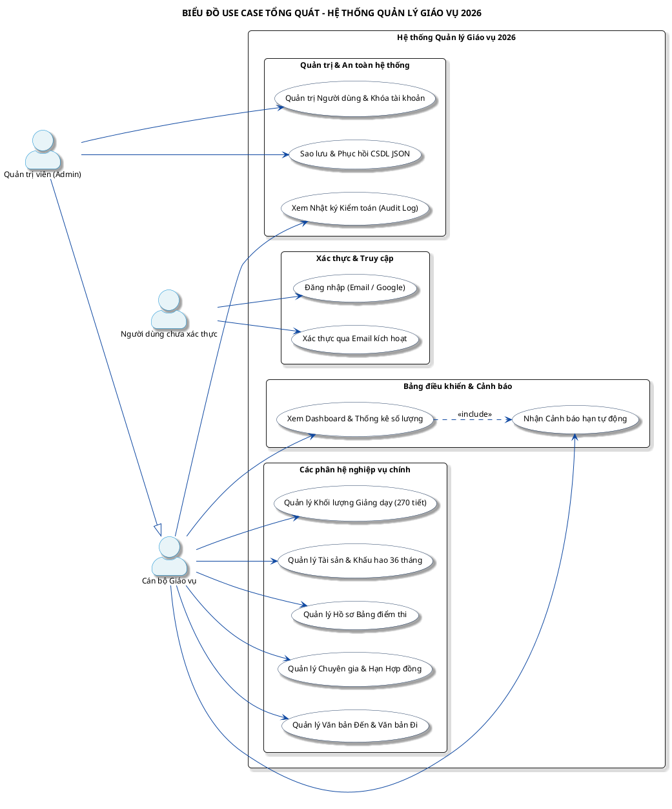
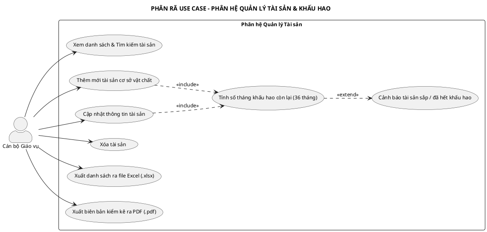
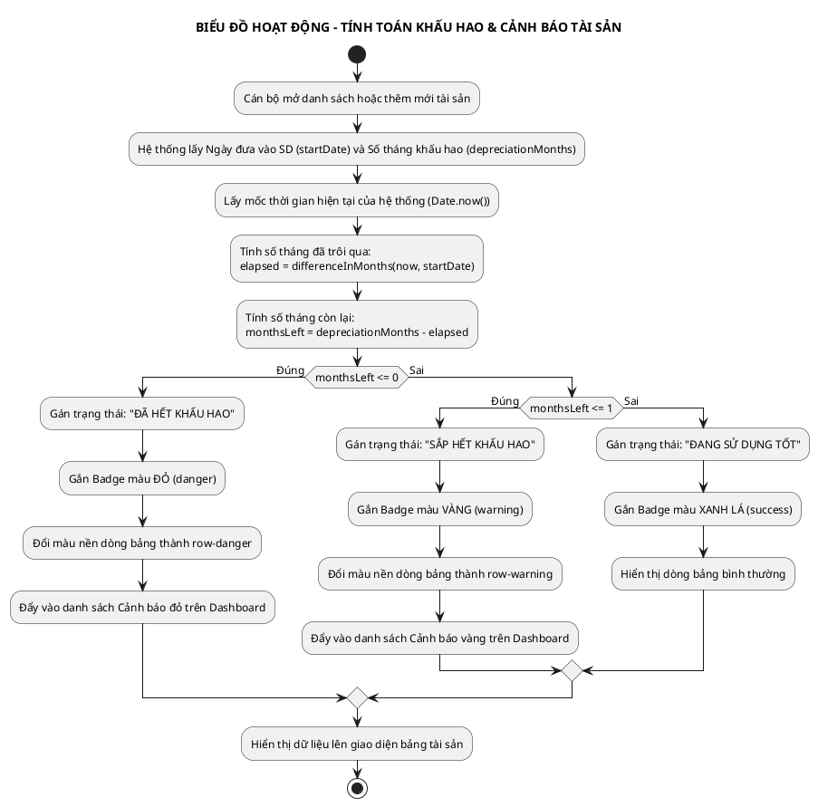
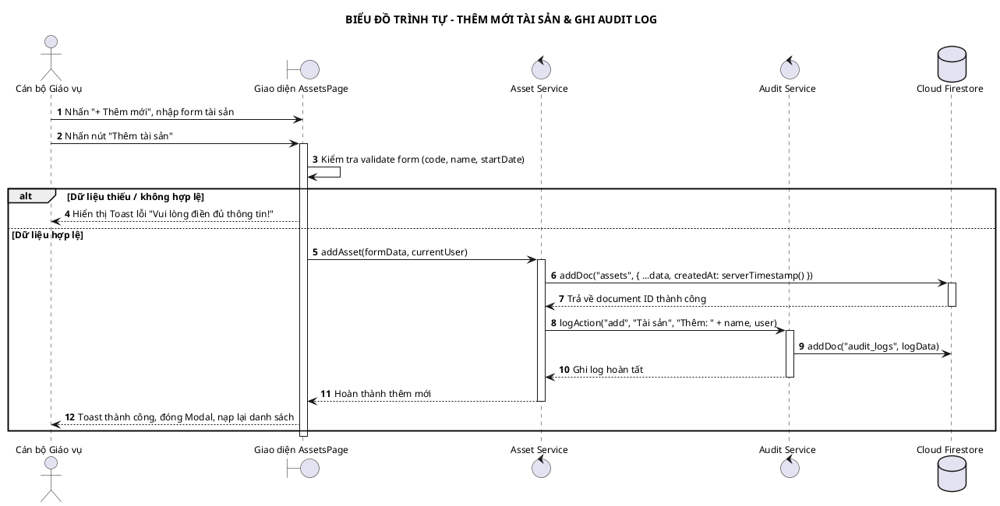
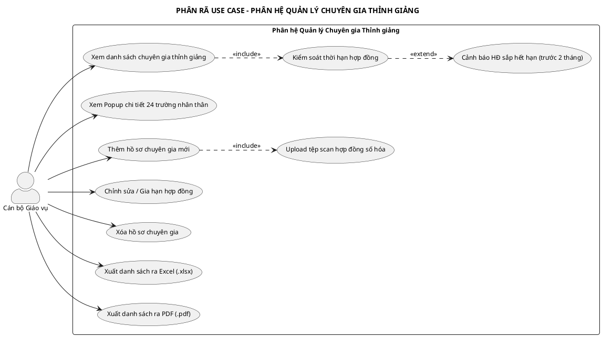
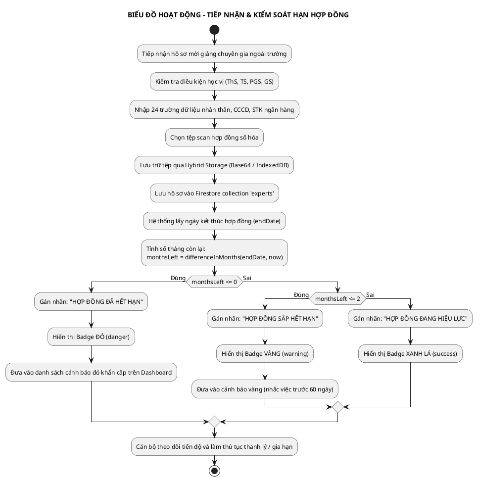
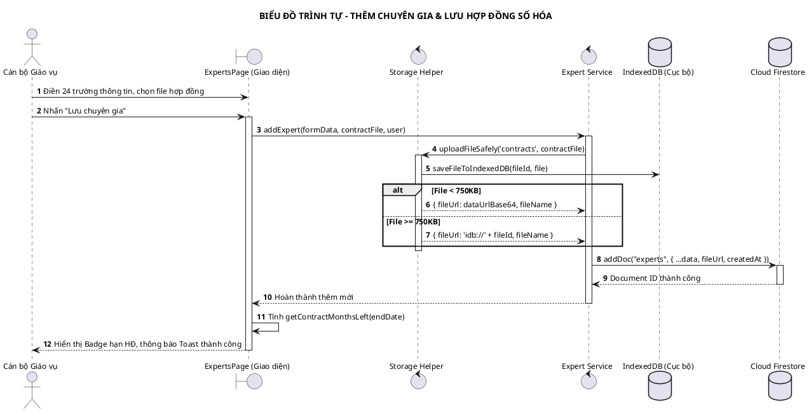
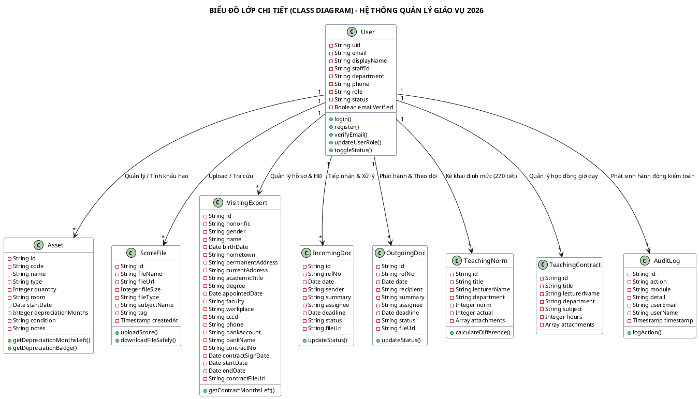
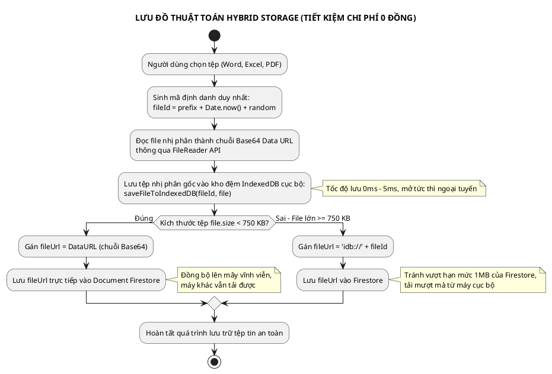

# CHƯƠNG 2: TRIỂN KHAI THỰC HIỆN
*(Dành riêng cho Báo cáo Thực tập Tốt nghiệp - Khoa CNTT Trường Đại học Điện Lực)*

---

## 2.1 XÂY DỰNG PHẦN MỀM (PHÂN TÍCH VÀ THIẾT KẾ HƯỚNG ĐỐI TƯỢNG)

### 2.1.1 Xác định yêu cầu và tác nhân hệ thống
Dựa trên quá trình khảo sát thực tế các quy trình nghiệp vụ giáo vụ tại đơn vị thực tập, hệ thống xác định 3 tác nhân chính tham gia tương tác:
1. **Cán bộ Giáo vụ (Academic Staff):** Là người dùng nghiệp vụ thường nhật. Có quyền thực thi các chức năng: Quản lý tài sản (theo dõi khấu hao), Quản lý hồ sơ bảng điểm, Quản lý chuyên gia thỉnh giảng và hợp đồng, Quản lý văn bản hành chính đến/đi, Kê khai đối soát khối lượng giờ giảng định mức, Xem bảng điều khiển Dashboard và tra cứu lịch sử Audit Log.
2. **Quản trị viên (Admin):** Người chịu trách nhiệm vận hành hệ thống kỹ thuật. Có toàn quyền của Cán bộ giáo vụ, đồng thời có đặc quyền: Quản trị tài khoản cán bộ, Phân quyền vai trò (Admin / Staff), Khóa / Mở khóa tài khoản, Sao lưu toàn diện CSDL ra tệp JSON và Phục hồi dữ liệu từ bản sao lưu.
3. **Người dùng chưa xác thực (Guest):** Tài khoản mới đăng ký nhưng chưa bấm liên kết xác thực trong email. Bị chặn truy cập toàn bộ dữ liệu học vụ, chỉ được thao tác tại trang xác minh email (`VerifyEmailPage`).

---

### 2.1.2 Biểu đồ Use Case tổng quát
Biểu đồ Use Case tổng quát mô tả toàn cảnh các gói chức năng chính mà hệ thống cung cấp cho các tác nhân.

#### Mã nguồn vẽ trên PlantText (Copy & Paste vào planttext.com):

*Hình 2.1: Biểu đồ Use Case tổng quát hệ thống Quản lý Giáo vụ 2026*

---

### 2.1.3 Phân rã chi tiết 02 chức năng chính

#### CHỨC NĂNG CHÍNH 1: QUẢN LÝ TÀI SẢN VÀ TÍNH TOÁN KHẤU HAO ĐỘNG

##### a. Biểu đồ Use Case phân rã chức năng Quản lý Tài sản

*Hình 2.2: Biểu đồ phân rã Use Case Phân hệ Quản lý Tài sản*

##### b. Đặc tả Use Case: Thêm mới Tài sản & Tính khấu hao tự động
*Bảng 2.1: Đặc tả Use Case Thêm mới và tính khấu hao tài sản*
| Thuộc tính đặc tả | Nội dung chi tiết |
| :--- | :--- |
| **Mã Use Case** | **UC-ASSET-01** |
| **Tên Use Case** | Thêm mới Tài sản và Tính toán Khấu hao tự động |
| **Tác nhân (Actor)**| Cán bộ Giáo vụ, Quản trị viên (Admin) |
| **Mô tả tóm tắt** | Cán bộ nhập thông tin tài sản, máy chiếu, trang thiết bị phòng học mới đưa vào sử dụng; hệ thống tự động tính số tháng khấu hao còn lại dựa trên chu kỳ 36 tháng, gắn nhãn màu sắc và kích hoạt cảnh báo tương ứng |
| **Tiền điều kiện** | Cán bộ đã đăng nhập thành công và tài khoản đã được xác thực qua Email |
| **Hậu điều kiện** | Tài sản được lưu trữ vào Firestore collection `assets`; hiển thị ngay trên bảng; tự động ghi nhật ký vào `audit_logs` |
| **Luồng sự kiện chính**| 1. Cán bộ nhấn nút **"+ Thêm mới"** trên giao diện Tài sản.<br>2. Hệ thống hiển thị hộp thoại Modal gồm các trường: Mã tài sản, Tên tài sản, Loại tài sản, Số lượng, Phòng sử dụng, Ngày đưa vào SD, Thời gian khấu hao (mặc định 36 tháng), Tình trạng, Ghi chú.<br>3. Cán bộ nhập các trường dữ liệu và nhấn **"Thêm tài sản"**.<br>4. Hệ thống kiểm tra tính hợp lệ dữ liệu (Mã, Tên, Ngày SD không được để trống).<br>5. Hệ thống gọi service `addAsset()` ghi vào Firestore, tự động đồng bộ thời gian máy chủ `serverTimestamp()`.<br>6. Hệ thống thực thi hàm `getDepreciationMonthsLeft()` để xác định trạng thái khấu hao.<br>7. Hệ thống tự động ghi vết: `logAction('add', 'Tài sản', 'Thêm: ' + name, user)`.<br>8. Hiển thị Toast thông báo thành công, đóng Modal và nạp lại danh sách tài sản. |
| **Luồng ngoại lệ** | - **4a. Dữ liệu bắt buộc bị bỏ trống:** Hệ thống hiển thị Toast lỗi: *"Vui lòng điền đầy đủ thông tin bắt buộc!"* và giữ nguyên cửa sổ nhập liệu.<br>- **5a. Lỗi ngắt kết nối mạng:** Hệ thống báo lỗi lưu trữ và cho phép cán bộ ấn lưu lại. |

##### c. Biểu đồ hoạt động (Activity Diagram) - Nghiệp vụ Tính khấu hao tài sản

*Hình 2.3: Biểu đồ hoạt động tính toán khấu hao và kích hoạt cảnh báo*

##### d. Biểu đồ trình tự (Sequence Diagram) - Nghiệp vụ Thêm mới Tài sản

*Hình 2.4: Biểu đồ trình tự Thêm mới tài sản và ghi nhật ký kiểm toán*

---

#### CHỨC NĂNG CHÍNH 2: QUẢN LÝ CHUYÊN GIA THỈNH GIẢNG VÀ HỢP ĐỒNG

##### a. Biểu đồ Use Case phân rã chức năng Quản lý Chuyên gia Thỉnh giảng

*Hình 2.5: Biểu đồ phân rã Use Case Quản lý Chuyên gia Thỉnh giảng*

##### b. Đặc tả Use Case: Quản lý Hồ sơ Chuyên gia & Hạn Hợp đồng
*Bảng 2.2: Đặc tả Use Case Quản lý Chuyên gia Thỉnh giảng*
| Thuộc tính đặc tả | Nội dung chi tiết |
| :--- | :--- |
| **Mã Use Case** | **UC-EXPERT-01** |
| **Tên Use Case** | Thêm mới Hồ sơ Chuyên gia và Kiểm soát Hạn Hợp đồng |
| **Tác nhân (Actor)**| Cán bộ Giáo vụ, Quản trị viên |
| **Mô tả tóm tắt** | Cán bộ tiếp nhận và nhập đầy đủ 24 trường thông tin nhân thân, bằng cấp, CCCD, số tài khoản ngân hàng và hợp đồng mời giảng của chuyên gia; hệ thống tự động kiểm tra thời hạn và cảnh báo trước 60 ngày |
| **Tiền điều kiện** | Cán bộ đã đăng nhập; có file mềm hợp đồng có chữ ký |
| **Hậu điều kiện** | Bản ghi chuyên gia lưu vào collection `experts`; file hợp đồng lưu trữ an toàn; tự động hiển thị trên Dashboard nếu hợp đồng còn $\le 2$ tháng |
| **Luồng sự kiện chính**| 1. Cán bộ nhấn **"+ Thêm chuyên gia"**.<br>2. Nhập thông tin: Danh xưng (Ông/Bà), Giới tính, Họ tên, Ngày sinh, Quê quán, Địa chỉ thường trú, Nơi ở hiện tại, Số CCCD (12 số), Học hàm, Học vị, Đơn vị tiếp nhận tại trường, Cơ quan công tác chính, Số điện thoại, STK ngân hàng, Tên ngân hàng, Số HĐ, Ngày ký, Từ ngày, Đến ngày.<br>3. Chọn file đính kèm hợp đồng (PDF/Word).<br>4. Nhấn **"Thêm chuyên gia"**.<br>5. Hệ thống gọi `uploadFileSafely()` để lưu trữ file qua cơ chế Hybrid Storage.<br>6. Lưu toàn bộ 24 trường dữ liệu vào Firestore collection `experts`.<br>7. Hệ thống tự động tính: `getContractMonthsLeft(endDate)`.<br>8. Ghi nhật ký vào `audit_logs` và hiển thị thông báo thành công. |
| **Luồng ngoại lệ** | - **Hạn hợp đồng không hợp lệ:** Ngày kết thúc trước ngày bắt đầu $\rightarrow$ Hệ thống cảnh báo lỗi logic thời gian và yêu cầu nhập lại. |

##### c. Biểu đồ hoạt động (Activity Diagram) - Tiếp nhận và Cảnh báo Hợp đồng Chuyên gia

*Hình 2.6: Biểu đồ hoạt động tiếp nhận và kiểm soát hạn hợp đồng*

##### d. Biểu đồ trình tự (Sequence Diagram) - Cảnh báo và Gia hạn Hợp đồng

*Hình 2.7: Biểu đồ trình tự lưu trữ hợp đồng và tính hạn*

---

### 2.1.4 Biểu đồ Lớp (Class Diagram) toàn hệ thống
Biểu đồ lớp phân tích cấu trúc tĩnh của toàn bộ các thực thể dữ liệu và mối liên kết quan hệ trong hệ thống:


*Hình 2.8: Biểu đồ Lớp phân tích chi tiết (Class Diagram) toàn hệ thống*

---

## 2.2 NGHIÊN CỨU THUẬT TOÁN

### 2.2.1 Cơ sở lý thuyết
1. **Lý thuyết khấu hao tài sản công cố định:** Theo chế độ quản lý tài sản nhà nước, thiết bị điện tử văn phòng và phòng học áp dụng phương pháp khấu hao đường thẳng trong chu kỳ 36 tháng (3 năm).
2. **Lý thuyết kiến trúc lưu trữ lai (Hybrid Storage Architecture):**
   - Vấn đề: Nền tảng Google Firebase gói miễn phí (Spark Plan) giới hạn không cho phép sử dụng dịch vụ Cloud Storage nếu không liên kết thẻ thanh toán quốc tế.
   - Giải pháp: Khai thác kết hợp giữa cơ sở dữ liệu phi quan hệ trình duyệt (**IndexedDB**) và **Cloud Firestore** thông qua kỹ thuật mã hóa tệp Base64 Data URI.

### 2.2.2 Phương pháp nghiên cứu
- **Phương pháp chuẩn hóa thời gian ISO-8601:** Sử dụng thư viện `date-fns` với các hàm `parseISO`, `differenceInMonths`, `isValid` để loại bỏ toàn bộ sai lệch về múi giờ giữa máy trạm người dùng và máy chủ.
- **Phương pháp phân luồng kích thước (Size-Threshold Routing):** Thiết lập ngưỡng chặn 750 KB để phân định luồng lưu trữ trên mây và lưu trữ đệm cục bộ.

### 2.2.3 Đề xuất giải pháp thuật toán

#### 1. Thuật toán tính toán khấu hao động
$$\text{MonthsLeft} = D - \left[ (Y_{\text{now}} - Y_{\text{start}}) \times 12 + (M_{\text{now}} - M_{\text{start}}) \right]$$
*Cài đặt trong `src/utils/dateUtils.js`:*
```javascript
export const getDepreciationMonthsLeft = (startDateStr, depreciationMonths) => {
  if (!startDateStr || !depreciationMonths) return null;
  const start = parseISO(startDateStr);
  if (!isValid(start)) return null;
  const elapsed = differenceInMonths(new Date(), start);
  return Number(depreciationMonths) - elapsed;
};
```

#### 2. Thuật toán Lưu trữ Lai Hybrid Storage 0ms

*Hình 2.9: Biểu đồ hoạt động thuật toán Hybrid Storage*

---

## 2.3 KIỂM THỬ

### 2.3.1 Phương pháp và công cụ áp dụng cho kiểm thử
* **Phương pháp kiểm thử:** Áp dụng phương pháp **Kiểm thử hộp đen (Black-box Testing)**, kiểm thử chức năng (Functional Testing) và kiểm thử giao diện người dùng (UI Testing).
* **Công cụ áp dụng:**
  - Chrome DevTools: Giám sát Network Throttling, Console kiểm tra lỗi, Application Tab kiểm tra cấu trúc dữ liệu IndexedDB `GiaoVuStorageDB`.
  - Lighthouse Audit: Kiểm định chỉ số hiệu năng và thời gian phản hồi trang.

### 2.3.2 Tài liệu đặc tả yêu cầu và mô hình kiểm thử
* **Mô hình kiểm thử:** Áp dụng mô hình kiểm thử hướng ca kiểm thử (Test Case-driven Verification).
* **Tiêu chí đánh giá Pass/Fail:**
  - Chức năng hoạt động đúng 100% theo hồ sơ đặc tả yêu cầu.
  - Tính toán khấu hao và định mức chính xác tuyệt đối, không có sai số.
  - Giao diện phản hồi thông báo Toast rõ ràng, không bị treo ứng dụng.

### 2.3.3 Xây dựng bộ kịch bản kiểm thử (Test Cases Suite)

*Bảng 2.3: Bảng kịch bản kiểm thử các chức năng chính*
| ID | Tên ca kiểm thử | Các bước thực hiện & Dữ liệu nhập | Kết quả mong đợi | Kết quả thực tế | Đánh giá |
| :---: | :--- | :--- | :--- | :--- | :---: |
| **TC01** | Thêm mới tài sản hợp lệ | Nhập Mã: 'TS-01', Tên: 'Máy chiếu Epson', Ngày SD: '01/01/2026', Khấu hao: 36 tháng | Lưu CSDL, tính trạng thái "Còn 33 tháng", Badge xanh | Lưu thành công, hiển thị đúng Badge xanh | **ĐẠT** |
| **TC02** | Bỏ trống thông tin bắt buộc | Để trống Mã và Tên tài sản. Nhấn "Thêm tài sản" | Hệ thống chặn lại, hiển thị Toast đỏ cảnh báo | Toast đỏ: "Vui lòng điền đầy đủ thông tin bắt buộc!" | **ĐẠT** |
| **TC03** | Khấu hao tài sản hết hạn | Nhập Ngày SD: '01/01/2022', Khấu hao: 36 tháng | Gán "Đã hết khấu hao", dòng bảng màu đỏ, hiện trên Dashboard | Dòng đổi màu đỏ, Dashboard hiển thị mục cần chú ý | **ĐẠT** |
| **TC04** | Xuất danh sách tài sản ra PDF | Nhấn nút "Xuất PDF" trên thanh công cụ | Tải về file `DanhSachTaiSan.pdf`, tiếng Việt có dấu rõ nét | Tải về file PDF chuẩn khổ A4, không lỗi font | **ĐẠT** |
| **TC05** | Upload file điểm thi an toàn | Chọn file `DiemToanA1.xlsx` (150KB), môn: 'Toán A1', tag: 'Toán học' | Lưu Base64 lên Firestore, hiển thị trên bảng, tải về được | Upload thành công trong 0.7s, tải về đúng file gốc | **ĐẠT** |
| **TC06** | Thêm chuyên gia & Cảnh báo HĐ | Nhập HĐ có ngày kết thúc sau ngày hiện tại 1 tháng | Gắn nhãn "Còn 1 tháng", Badge vàng, cảnh báo Dashboard | Dòng bảng màu vàng, Dashboard báo HĐ sắp hết hạn | **ĐẠT** |
| **TC07** | Xem Popup chi tiết nhân thân | Nhấn nút "Xem chi tiết" tại một chuyên gia | Hiển thị Modal với đủ 24 trường dữ liệu, CCCD, STK | Hiển thị đầy đủ thông tin khoa học trong popup | **ĐẠT** |
| **TC08** | Cập nhật trạng thái văn bản | Chọn trực tiếp từ Dropdown trên bảng: chuyển sang "Đã xử lý" | Cập nhật tức thì CSDL, huy hiệu Badge giảm 1 | Cập nhật ngay, Badge giảm 1, ghi Audit Log | **ĐẠT** |
| **TC09** | Tính chênh lệch định mức KLGD | Định mức: 270 tiết, Thực tế giảng dạy: 315 tiết | Tự động tính chênh lệch: `+45 vượt`, Badge vàng | Hiển thị đúng Badge vàng "+45 vượt" | **ĐẠT** |
| **TC10** | Tự động ghi vết Audit Log | Cán bộ xóa một văn bản thử nghiệm | Bảng Audit Log xuất hiện dòng đầu tiên: hành động "delete" | Ghi nhận chính xác: "Xóa: [Số hiệu]", email cán bộ, giờ | **ĐẠT** |
